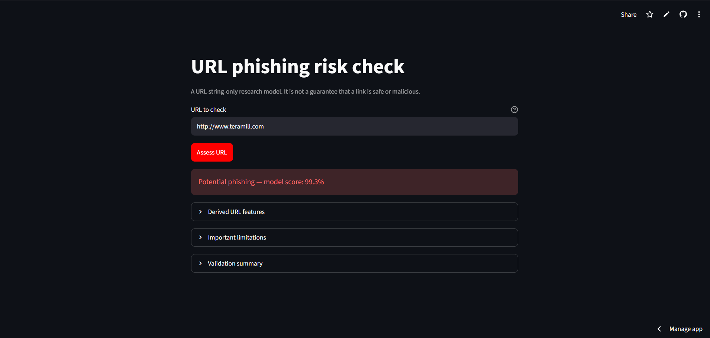
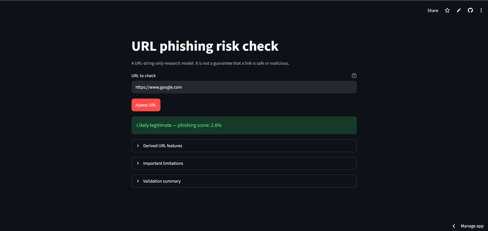

# Raw-URL Phishing Detection

A machine-learning web app that estimates whether a URL may be a phishing link using **URL-string features only**. Built with Python, scikit-learn, and Streamlit.

<p align="center">
  <a href="https://phishing-url-detection-a8whjsyefcrze4ykhdevec.streamlit.app/"><strong>Try the live demo</strong></a>
  ·
  <a href="https://github.com/abduladhill/phishing-url-detection">View source code</a>
</p>

> **Important:** This is an educational/research project, not a security guarantee. Do not use its prediction as the only basis for deciding whether a link is safe.

## Project overview

Phishing links often use URL patterns intended to look trustworthy or disguise a destination. This project extracts measurable characteristics from a submitted URL and uses a trained classifier to estimate its phishing risk.

A key design choice is that the model is trained from the dataset's `URL` and `label` columns only. It does **not** depend on fields such as `URLSimilarityIndex`, TLD probabilities, webpage/DOM values, page titles, redirects, or other information that cannot be reliably recreated from a pasted URL alone.


## Application Screenshots

### Potential phishing result

The application flags a URL as potential phishing and displays the model's phishing score.



### Likely legitimate result

The application classifies a Google URL as likely legitimate and displays its phishing score.



**Try it yourself:** [Open the live phishing URL detector](https://phishing-url-detection-a8whjsyefcrze4ykhdevec.streamlit.app/)


## Features

- Predicts a submitted URL as **potential phishing** or **likely legitimate**.
- Displays a phishing score from the model.
- Shows the derived URL features used for the prediction.
- Uses a hostname-grouped holdout evaluation to prevent the same normalized hostname appearing in both train and test sets.
- Does not fetch or visit the submitted link.

## Model and evaluation

The current model is an `ExtraTreesClassifier` trained on 25 lexical URL/host/path/query features. The split uses `GroupShuffleSplit` grouped by normalized hostname, with random state `42`.

Evaluation results saved in [`artifacts/metrics.json`](artifacts/metrics.json):

| Metric | Result |
|---|---:|
| Accuracy | 96.66% |
| Phishing precision | 97.87% |
| Phishing recall | 94.31% |
| Phishing F1-score | 96.06% |
| Legitimate precision | 95.79% |
| Legitimate recall | 98.44% |
| Legitimate F1-score | 97.10% |

The held-out test set contains 47,583 rows. There were **zero overlapping normalized hostname groups** between training and testing.

These metrics describe performance on this dataset and split; they do not establish how well the model will perform on new phishing campaigns or future URLs. A separate, recent external dataset would be needed for stronger evidence of real-world generalization.

## How it works

1. The user enters a URL including `http://` or `https://`.
2. The app normalizes the URL and extracts the same ordered features used during training.
3. The saved Extra Trees model returns a prediction and phishing probability.
4. The app displays the result and lets the user inspect the derived features.

The model uses URL/host/path/query lengths; punctuation counts; digit, letter, and special-character ratios; HTTPS; IP-literal host; subdomain count; port; punycode; and percent-encoding presence. The authoritative feature order is stored in [`artifacts/feature_names.json`](artifacts/feature_names.json).

## Run locally

### Requirements

- Python 3.10 or later recommended
- pip

### Installation (Windows PowerShell)

Clone the repository and enter its folder:

```powershell
git clone https://github.com/abduladhill/phishing-url-detection.git
cd phishing-url-detection
python -m venv .venv
.\.venv\Scripts\Activate.ps1
pip install -r requirements.txt
```

### Start the app

The repository needs the trained model at `artifacts/raw_url_extra_trees.joblib`.

```powershell
streamlit run app.py
```

Streamlit will print a local URL in the terminal. Open that address in your browser.

### Train the model again

Download the PhiUSIIL dataset separately and pass the CSV path to the training script:

```powershell
python train.py --data "C:\path\to\PhiUSIIL_Phishing_URL_Dataset.csv"
```

Training writes the model and evaluation artifacts to `artifacts/`. Dataset access and licensing are governed by the dataset provider's terms.

## Repository structure

```text
phishing-url-detection/
├── app.py
├── train.py
├── requirements.txt
├── README.md
├── screenshots/
│   ├── phishing-result.png
│   └── legitimate-result.png
└── artifacts/
    ├── feature_names.json
    ├── metrics.json
    └── raw_url_extra_trees.joblib
```

## Limitations

- The model examines URL text only. It does not inspect the live website, page content, domain reputation, redirects, or certificate details.
- A URL classified as likely legitimate may still be malicious; a phishing score is not proof of intent.
- URL patterns and phishing campaigns change over time. Evaluate against recent, independent data before considering operational use.
- This project does not replace browser protections, security software, or careful verification of unexpected links.

## Next improvements

- Evaluate on a recent external URL dataset and report false-positive/false-negative examples.
- Add automated tests for URL normalization and feature extraction.
